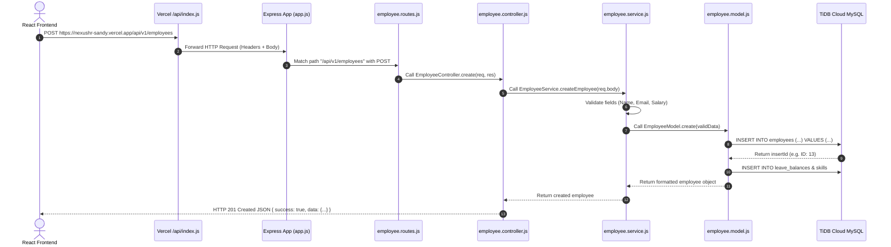

# 📘 NexusHR Backend: Zero to Hero Complete Guide (Hinglish)
> **Target Audience**: Beginners jinke liye Backend bilkul naya hai.  
> **Repository**: [shilpai/nexushr](https://github.com/shilpai/nexushr.git)  
> **Live API URL**: `https://nexushr-sandy.vercel.app/api/v1`  
> **Live Database**: TiDB Cloud Serverless MySQL (AWS Tokyo Gateway)

---

## 📑 विषय-सूची (Table of Contents)
1. [Backend क्या होता है? (Restaurant Analogy)](#1-backend-क्या-होता-है-restaurant-analogy)
2. [Modular Monolith Architecture क्या है और क्यों चुना?](#2-modular-monolith-architecture-क्या-है)
3. [Folder Structure — एक-एक फ़ाइल और फ़ोल्डर का Use Case](#3-folder-structure--एक-एक-फ़ाइल-का-use-case)
4. [एक API Request का पूरा सफ़र (Request-Response Lifecycle)](#4-एक-api-request-का-पूरा-सफ़र-lifecycle)
5. [Database: TiDB Cloud Serverless MySQL](#5-database-tidb-cloud-serverless-mysql)
6. [Free Cloud Deployment (Vercel Serverless)](#6-free-cloud-deployment-vercel-serverless)
7. [Debugging & Real Errors Solved (जो गलतियाँ आई थीं और कैसे ठीक हुईं)](#7-debugging--real-errors-solved)
8. [API Endpoints Reference List](#8-api-endpoints-reference-list)

---

## 1. Backend क्या होता है? (Restaurant Analogy)

अगर आपने पहले सिर्फ Frontend (HTML, CSS, React) पर काम किया है, तो Backend को एक **रेस्टोरेंट** के उदाहरण से समझें:

| रेस्टोरेंट का हिस्सा | वेब डेवलपमेंट में समतुल्य | काम क्या है? |
| :--- | :--- | :--- |
| **Dining Hall / Menu** | **Frontend (React)** | जो कस्टमर को दिखता है — सुंदर बटन, फ़ॉर्म, कार्ड्स, टेबल। |
| **Waiter (वेटर)** | **API (HTTP Requests)** | टेबल से ऑर्डर लेकर किचन तक पहुँचाना और खाना वापस लाना। |
| **Kitchen (रसोई / शेफ)** | **Backend (Node.js + Express)** | बिज़नेस लॉजिक — कौन सा ऑर्डर वैलिड है? डेटा को कैसे प्रोसेस करना है? सुरक्षा जांचना। |
| **Store Room (राशन गोदाम)** | **Database (MySQL / TiDB Cloud)** | जहाँ सारा कच्चा माल (यूज़र डेटा, पासवर्ड, एम्प्लॉई लिस्ट) हमेशा के लिए सुरक्षित स्टोर रहता है। |

Frontend कभी भी सीधे Database से बात **नहीं** कर सकता (क्योंकि इससे डेटाबेस का पासवर्ड हर यूज़र के ब्राउज़र में लीक हो जाएगा)। इसलिए बीच में **Backend** एक सुरक्षित पहरेदार (Security Guard & Brain) की तरह बैठता है।

---

## 2. Modular Monolith Architecture क्या है?

NexusHR के बैकएंड के लिए हमने **"Modular Monolith"** आर्किटेक्चर चुना है।

### बाकी विकल्पों से यह बेहतर क्यों है?
1. **Simple Monolith**: सब कुछ एक ही बड़े फ़ोल्डर में मिक्स होता है। 1 महीने बाद कोड इतना उलझ जाता है कि नया फ़ीचर जोड़ना सिरदर्द बन जाता है।
2. **Microservices**: हर फ़ीचर (Employee, Leave, Payroll) के लिए अलग-अलग 5 सर्वर और 5 डेटाबेस बनाओ। यह बहुत मुश्किल और महंगा होता है।
3. **Modular Monolith (हमारा विकल्प)**: 
   - सर्वर **एक ही** रहता है (डिप्लॉय करना बहुत आसान और 100% मुफ़्त)।
   - लेकिन अंदर का कोड अलग-अलग **मॉड्यूल्स (Modules)** में बँटा होता है — जैसे `employee`, `department`, `leave`, `attendance`, `payroll`।
   - कल को अगर आपको नया मॉड्यूल (जैसे `training` या `recruitment`) जोड़ना हो, तो पुराने किसी कोड को छुए बिना सिर्फ एक नया फ़ोल्डर `src/modules/recruitment` बनाकर प्लग कर सकते हैं!

---

## 3. Folder Structure — एक-एक फ़ाइल का Use Case

```text
Backend/
├── api/
│   └── index.js                 <-- Vercel Serverless Function entry point
├── src/
│   ├── app.js                   <-- Express Application config (Middlewares, CORS)
│   ├── server.js                <-- Local dev server runner (app.listen on port 5000)
│   ├── config/
│   │   ├── db.config.js         <-- Database connection pool (TiDB Cloud MySQL + SSL)
│   │   └── env.config.js        <-- Environment variables validation & defaults
│   ├── database/
│   │   ├── schema.sql           <-- 8 SQL Tables definition (DDL)
│   │   ├── initDb.js            <-- Script to create all tables in Cloud DB
│   │   └── seed.js              <-- Script to insert initial dummy demo data
│   ├── middlewares/
│   │   └── errorHandler.middleware.js <-- Central error catching & 404 handler
│   ├── routes/
│   │   └── api.routes.js        <-- Master Router (jodta hai saare modules ke routes ko)
│   ├── utils/
│   │   └── apiResponse.js       <-- Standard JSON response format helper
│   └── modules/
│       ├── employee/            <-- Employee Core Module
│       │   ├── employee.routes.js     <-- URLs define karta hai (/employees)
│       │   ├── employee.controller.js <-- Request/Response handle karta hai
│       │   ├── employee.service.js    <-- Business logic & checks
│       │   ├── employee.model.js      <-- Database queries (SQL queries)
│       │   └── employee.validation.js <-- Form data check karta hai (name, email)
│       ├── department/          <-- Department Module
│       ├── leave/               <-- Leave Management Module (HRMS)
│       ├── attendance/          <-- Attendance Tracking Module
│       └── payroll/             <-- Payroll & Salary Ledger Module
├── .env                         <-- Secret keys (DB password, host) [Git ignored]
├── .env.example                 <-- Template for other developers
├── package.json                 <-- Project dependencies & NPM scripts
└── vercel.json                  <-- Vercel cloud deployment routing instructions
```

---

### 📂 फ़ाइलों की विस्तृत व्याख्या (Deep-Dive)

#### 1. `src/server.js` vs `api/index.js`
- **`src/server.js`**: जब आप अपने कंप्यूटर पर `npm run dev` चलाते हैं, तो यह फ़ाइल `app.listen(5000)` चलाकर आपके लोकल पोर्ट 5000 पर सर्वर को चालू रखती है।
- **`api/index.js`**: Vercel पर 24/7 चलने वाला पारंपरिक सर्वर नहीं होता; वहाँ **Serverless Functions** होते हैं। जब कोई इंटरनेट से रिक्वेस्ट भेजता है, तो Vercel `api/index.js` को जगाता है, रिक्वेस्ट हैंडल करता है, और फिर बंद हो जाता है। इससे एक रुपया भी खर्च नहीं होता!

#### 2. `src/app.js` (The Engine)
- यह पूरे बैकएंड का दिल है। यहाँ हमने:
  - **`cors()`**: सेट किया ताकि हमारी React वेबसाइट (चाहे localhost पर हो या Vercel पर) बैकएंड से सुरक्षित डेटा मांग सके।
  - **`express.json()`**: सेट किया ताकि फ़्रंटएंड जो JSON डेटा भेजता है, उसे बैकएंड समझ सके (`req.body`)।
  - **`morgan('dev')`**: सेट किया ताकि टर्मिनल में हर आने वाली रिक्वेस्ट (GET, POST) रंग-बिरंगी दिखाई दे।
  - **`app.use('/api/v1', apiRoutes)`**: मास्टर राउटर को माउंट किया।

#### 3. `src/config/db.config.js` (डेटाबेस का दरवाजा)
- इसमें हमने **MySQL Connection Pooling (`mysql2/promise`)** का इस्तेमाल किया है।
- **Connection Pool क्या है?** हर बार नया कनेक्शन खोलने और बंद करने में समय बर्बाद होता है। Pool एक साथ 10 कनेक्शन तैयार रखता है, जो भी रिक्वेस्ट आती है उसे तुरंत डेटा देकर कनेक्शन खाली कर देती है।
- **SSL (`ssl: { rejectUnauthorized: true }`)**: TiDB Cloud इंटरनेट पर चलता है, इसलिए डेटा हैकर्स से बचाने के लिए एनक्रिप्टेड SSL टनल से ही कनेक्ट होता है।

#### 4. `src/modules/employee/` (Layered Architecture Pattern)
एक मॉड्यूल 4 लेयर्स में काम करता है:
1. **`employee.routes.js` (रास्ता)**:
   - बताता है कि कौन से URL पर कौन सा फ़ंक्शन चलेगा।
   - उदाहरण: `router.get('/', EmployeeController.getAll);`
2. **`employee.controller.js` (मैनेजर)**:
   - HTTP रिक्वेस्ट से डेटा निकालता है (`req.params`, `req.body`, `req.query`), सर्विस को देता है, और रिज़ल्ट आने पर `ApiResponse.success(res, data)` भेजता है।
3. **`employee.service.js` (दिमाग / लॉजिक)**:
   - चेक करता है कि डेटा सही है या नहीं (`validateEmployeePayload`), ज़रूरत पड़ने पर एम्प्लॉई कोड जनरेट करता है (`EMP-1013`), और फिर मॉडल को कॉल करता है।
4. **`employee.model.js` (डेटाबेस का कारीगर)**:
   - यहाँ शुद्ध SQL क्वेरीज़ लिखी जाती हैं:
     ```sql
     SELECT e.*, MAX(COALESCE(lb.total_allowance, 24)) as totalLeaves
     FROM employees e ...
     ```
   - डेटाबेस से आने वाले डेटा को साफ़-सुथरे ऑब्जेक्ट में बदलकर फ़्रंटएंड के लिए तैयार करता है (`formatEmployeeRecord`).
5. **`employee.validation.js` (सेंसर बोर्ड)**:
   - चेक करता है कि यूज़र ने नाम खाली तो नहीं छोड़ा, ईमेल में `@` है या नहीं, सैलरी माइनस में तो नहीं है।

---

## 4. एक API Request का पूरा सफ़र (Lifecycle)

मान लीजिए फ़्रंटएंड पर किसी ने नया एम्प्लॉई जोड़ने के लिए **"Save"** बटन दबाया:



---

## 5. Database: TiDB Cloud Serverless MySQL

हमने अपने बैकएंड के लिए **TiDB Cloud Serverless** को चुना।
- **TiDB क्या है?** यह 100% MySQL कम्पैटिबल, डिस्ट्रीब्यूटेड SQL डेटाबेस है। यानी आप इसमें साधारण MySQL की सारी क्वेरीज़ चला सकते हैं।
- **फायदे**:
  - **100% मुफ़्त**: 5 GB स्टोरेज हमेशा के लिए फ्री मिलता है।
  - **कोई क्रेडिट कार्ड नहीं**: अकाउंट बनाने के लिए किसी बैंक कार्ड की ज़रूरत नहीं होती।
  - **Auto-Scaling**: अपने आप ट्रैफिक को हैंडल करता है।
  - **AWS Tokyo Datacenter**: बहुत तेज़ और हाई-अवेलेबिलिटी।

### हमारे डेटाबेस में 8 टेबल्स हैं:
1. `departments` — विभाग (Engineering, HR, Marketing, आदि)।
2. `employees` — कर्मचारियों का मुख्य डेटा (नाम, ईमेल, सैलरी, रोल, फोटो)।
3. `employee_skills` — स्किल्स (React, Node.js, SQL, आदि)।
4. `leave_types` — छुट्टियों के प्रकार (Paid, Sick, Casual)।
5. `leave_balances` — सालाना छुट्टियों का बैलेंस (टोटल: 24, ली गई छुट्टियां: 2)।
6. `leave_requests` — छुट्टी के आवेदन (Pending, Approved, Rejected)।
7. `attendance_logs` — दैनिक उपस्थिति (Present, Remote, Late)।
8. `payroll_records` — सैलरी स्लिप और बोनस का हिसाब-किताब।

---

## 6. Free Cloud Deployment (Vercel Serverless)

Render जैसे प्लेटफॉर्म्स नए यूज़र्स से कार्ड की जानकारी माँग रहे थे। इसलिए हमने Backend को **Vercel Serverless Functions** पर डिप्लॉय किया।

### यह कैसे काम करता है?
1. **`vercel.json`**:
   ```json
   {
     "version": 2,
     "builds": [
       { "src": "api/index.js", "use": "@vercel/node" }
     ],
     "routes": [
       { "src": "/(.*)", "dest": "api/index.js" }
     ]
   }
   ```
   यह Vercel को बताता है कि आने वाली हर एक रिक्वेस्ट (`/*`) को सीधे हमारे Express हैंडलर (`api/index.js`) पर भेज दो।
2. **Environment Variables**:
   Vercel Dashboard में हमने `DATABASE_URL` को सुरक्षित तरीके से स्टोर किया, जिससे डेटाबेस का पासवर्ड कभी भी GitHub पर पब्लिक नहीं होता।

---

## 7. Debugging & Real Errors Solved

इस प्रोजेक्ट के दौरान हमें 5 बड़ी चुनौतियाँ आईं, जिन्हें हमने स्टेप-बाय-स्टेप हल किया:

### ⚠️ Challenge 1: Git में 200,000 `node_modules` फ़ाइलें ट्रैक हो रही थीं
- **समस्या**: प्रोजेक्ट के रूट में `.gitignore` नहीं था, जिससे `git add .` करने पर सारी भारी-भरकम लाइब्रेरीज GitHub पर जाने लगीं।
- **समाधान**: 
  - रूट में `.gitignore` बनाया।
  - `git rm -r --cached Backend/node_modules` चलाकर ट्रैकिंग हटाई और क्लीन कमिट किया।

### ⚠️ Challenge 2: TiDB Cloud Username Case-Sensitivity
- **समस्या**: डेटाबेस कनेक्शन पर एरर आ रहा था: `Access denied ... check user-name-prefix`.
- **कारण**: यूजरनेम में `4Ya4Lvb5LStkKV2.root` में छोटा `b` टाइप हो गया था, जबकि TiDB का क्लस्टर प्रीफिक्स बड़े `B` (`4Ya4LvB5LStkKV2.root`) के साथ था।
- **समाधान**: यूजरनेम का केस ठीक करके `.env` और Vercel एनवायरनमेंट में अपडेट किया।

### ⚠️ Challenge 3: MySQL 8 Strict Mode (`ONLY_FULL_GROUP_BY`)
- **समस्या**: `/api/v1/employees` पर एरर आया: `Expression #11 of SELECT list is not in GROUP BY clause and contains nonaggregated column`.
- **कारण**: MySQL 8 में जब आप `GROUP BY e.id` करते हैं, तो जॉइन की गई दूसरी टेबल के कॉलम्स (`lb.total_allowance`) को बिना एग्रीगेट फ़ंक्शन (जैसे `MAX` या `MIN`) के नहीं चुन सकते।
- **समाधान**: हमने क्वेरी को ठीक करके लिखा:
  ```sql
  MAX(COALESCE(lb.total_allowance, 24)) as totalLeaves,
  MAX(COALESCE(lb.used_days, 0)) as leavesTaken
  ```

### ⚠️ Challenge 4: Local Server `EADDRINUSE: :::5000`
- **समस्या**: टर्मिनल में बार-बार आ रहा था कि पोर्ट 5000 पहले से व्यस्त है।
- **कारण**: पिछला बैकग्राउंड प्रोसेस पोर्ट को पकड़े हुए था।
- **समाधान**: प्रोसेस को किल किया और सर्वर को नए सिरे से रीस्टार्ट किया।

### ⚠️ Challenge 5: Cross-Origin Resource Sharing (CORS)
- **समस्या**: ब्राउज़र दूसरे डोमेन से API कॉल को ब्लॉक कर सकता था।
- **समाधान**: `Backend/src/app.js` में डायनामिक ओरिजिन कॉलबैक सेट किया:
  ```javascript
  app.use(cors({
    origin: (origin, callback) => callback(null, true),
    credentials: true
  }));
  ```
  जिससे लोकलहोस्ट और Vercel का नया Frontend डोमेन दोनों बिना किसी रुकावट के डेटा ले सकें।

---

## 8. API Endpoints Reference List

| Method | Endpoint | Use Case |
| :--- | :--- | :--- |
| **GET** | `/api/v1/health` | सर्वर और डेटाबेस की सेहत जांचने के लिए |
| **GET** | `/api/v1/employees` | सारे एम्प्लॉईज़ की लिस्ट (सर्च, फ़िल्टर और सॉर्टिंग के साथ) |
| **GET** | `/api/v1/employees/:id` | किसी एक कर्मचारी का पूरा प्रोफ़ाइल |
| **POST** | `/api/v1/employees` | नया कर्मचारी रजिस्टर करना |
| **PUT** | `/api/v1/employees/:id` | कर्मचारी की जानकारी अपडेट करना |
| **DELETE**| `/api/v1/employees/:id` | कर्मचारी का रिकॉर्ड परमानेंट डिलीट करना |
| **POST** | `/api/v1/employees/bulk-delete` | एक साथ कई कर्मचारियों को डिलीट करना |
| **GET** | `/api/v1/departments` | सभी डिपार्टमेंट्स और उनके बजट की जानकारी |
| **GET** | `/api/v1/leaves/requests` | छुट्टियों के सभी आवेदन |
| **GET** | `/api/v1/attendance/roster` | आज की लाइव हाजिरी लिस्ट |
| **GET** | `/api/v1/payroll/summary` | कुल सैलरी बजट और औसत वेतन का आँकड़ा |

---

## 🎓 Summary: अब आप क्या समझ चुके हैं?
1. Node.js + Express में प्रोफेशनल लेयर्ड आर्किटेक्चर (Route -> Controller -> Service -> Model) कैसे बनता है।
2. Cloud MySQL (TiDB) से कनेक्शन पूल और SSL टनल कैसे सेटअप की जाती है।
3. बिना क्रेडिट कार्ड के Vercel Serverless पर बैकएंड को 100% फ्री में हमेशा के लिए कैसे लाइव किया जाता है।
4. React Frontend को लाइव क्लाउड डेटाबेस से कैसे जोड़ा जाता है।
